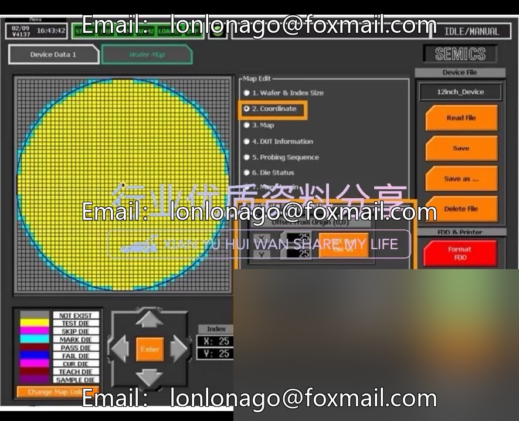
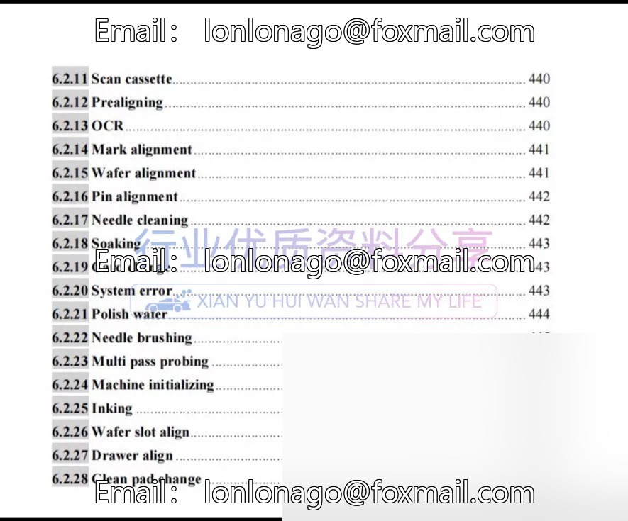
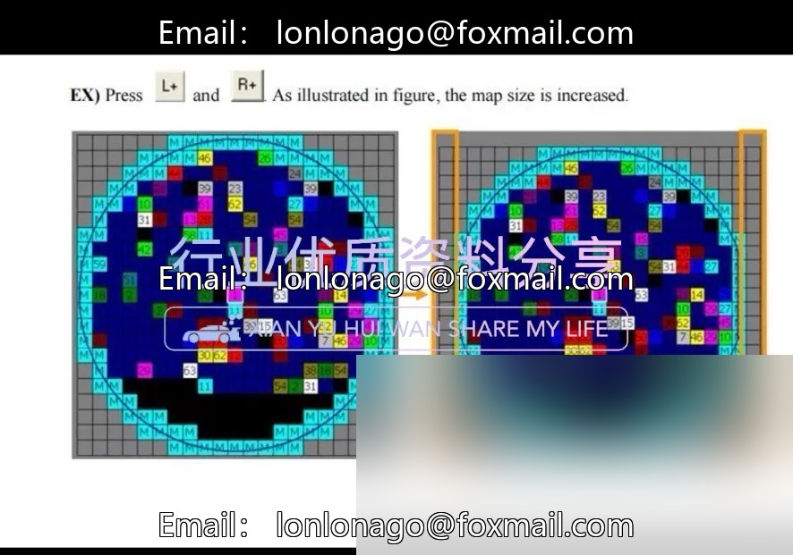
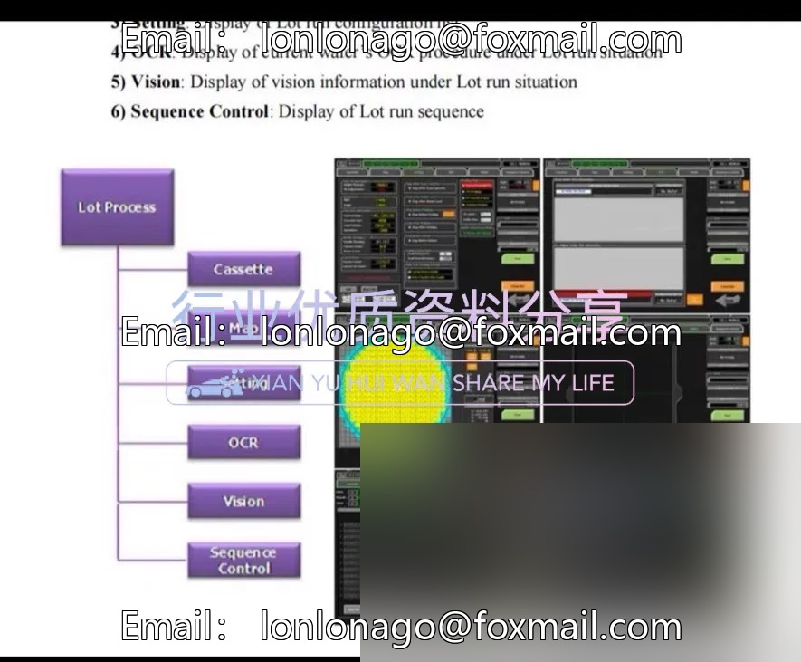
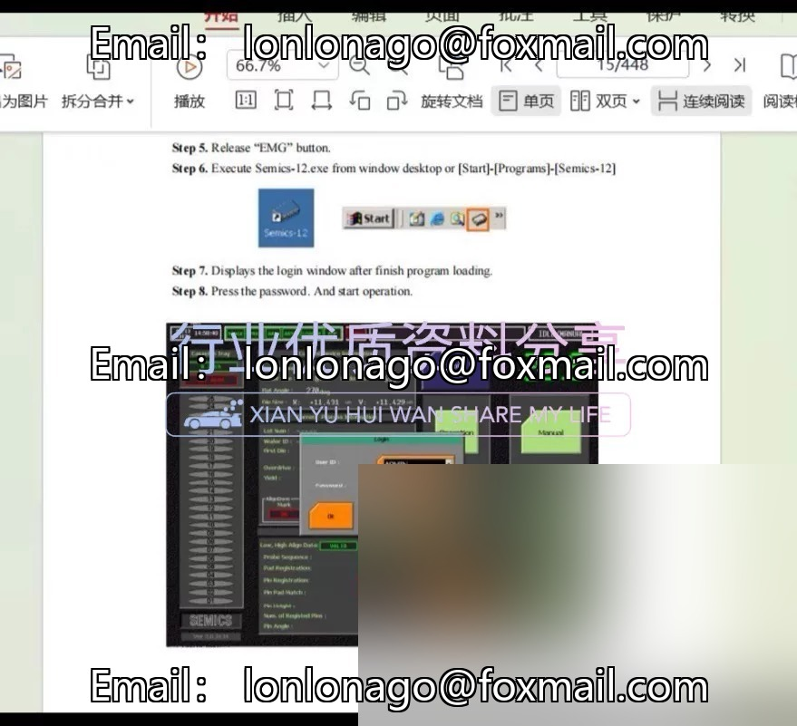
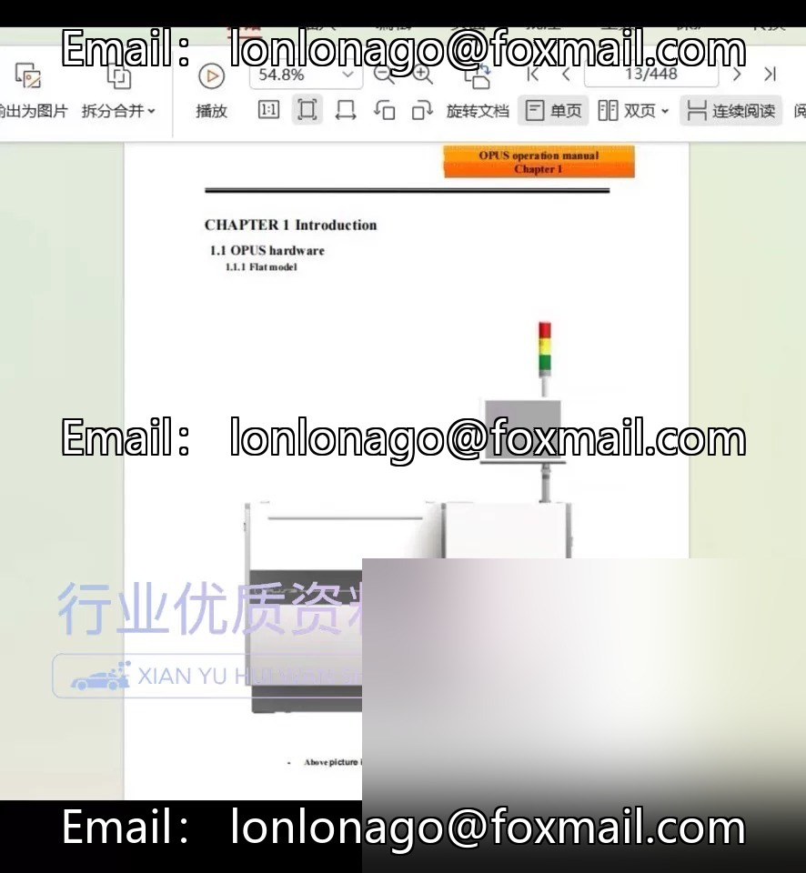

# Wafer probe testing: Korea OPUS probe station operation manual, there are a total of 448 pages, non-

## Body

Wafer probe testing: Korea OPUS probe stage operating manual, consisting of 448 pages, very detailed complete version, containing a large number of device interface operation explanations, very clear and clear!!

Capture and send the electronic original directly! The following images include screenshots of the file portion. Please confirm before placing the order! Due to the replicable nature of electronic documentation Therefore, are allowed after purchase! Thanks for understanding!

For personal learning and reference use only.

The Korean OPUS probe station operation manual is detailed with 448 pages, containing extensive device interface instructions and providing electronic original files along with screenshots.

<!-- AI_ENRICHED -->

## Images

## Payment

Here is a pay link on Stripe ( https://buy.stripe.com/3cs8yP7sY87d0vu9AB ). Please contact me lonlonago@foxmail.com after funding $89, and I will send you a complete data files , thank you!

